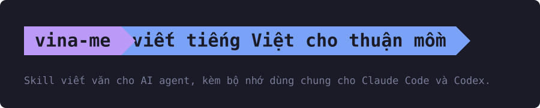
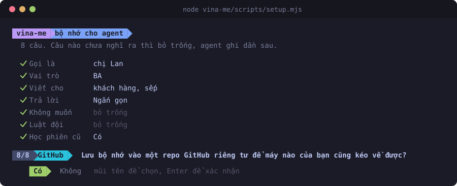

[](https://github.com/AnhTuan2111/vina-me/actions/workflows/test.yml)

Bạn nhờ AI viết một đoạn tiếng Việt, đọc lên là nhận ra ngay văn AI slop: câu nào cũng ngắn cũn như gạch đầu dòng, chữ thì
to tát mà chẳng nói được gì cụ thể, hết đoạn lại chốt thêm một câu tổng kết. vina-me dạy agent viết khác đi, để câu sau nối
vào câu trước như một người thật đang kể, dù là bài giảng, báo cáo gửi sếp, văn bản hành chính, email hay tệp Word. Cùng cách
viết ấy, cộng thêm các script dựng tệp Word và soát lỗi, agent còn làm được phần kỹ thuật của hồ sơ dự thầu. Cài một lần là
có thêm bộ nhớ dùng chung cho Claude Code và Codex, nên điều đã dặn agent một lần thì không phải dặn lại.

## Cài

Cần Node 18 trở lên và git.

```bash
git clone https://github.com/AnhTuan2111/vina-me.git
node vina-me/scripts/setup.mjs
```

Script hỏi tám câu, câu chọn thì dùng phím mũi tên. Phông của terminal hiện ô vuông thay cho mũi nhọn thì thêm `--plain`.



Trả lời xong là có:

- skill trong Claude Code và Codex, agent nào có trên máy thì cài cho agent đó;
- bộ nhớ ở `~/agent-memory/`: agent đọc ở đầu mỗi phiên, tự ghi khi bạn sửa hay khen một cách làm;
- repo GitHub riêng tư cho bộ nhớ nếu bạn chọn, tự lưu khi mở và đóng phiên, khi đăng nhập máy và mỗi 2 giờ;
- trong Claude Code, mỗi tin bạn gửi đi kèm một dòng nhắc agent soát câu trả lời theo vina-me, kể cả câu trả lời ngắn;
- vina-me tự lên bản phát hành mới nhất.

Cài trên máy thứ hai bằng đúng hai lệnh trên: script thấy repo bộ nhớ đã có thì kéo về, không hỏi lại.

Không quen dòng lệnh thì nhờ Claude Code cài giúp. Mở một phiên Claude Code ở thư mục nào cũng được rồi gõ:

> Cài giúp mình vina-me từ https://github.com/AnhTuan2111/vina-me. Clone repo về rồi làm theo mục "Agent cài thay người dùng" trong references/agent-memory.md.

Claude tự kiểm tra Node, git, tải vina-me về, hỏi bạn tám câu ngay trong chat rồi cài. Có một chỗ bạn phải tự làm: Claude đưa
một mã tám ký tự và một link GitHub, bạn mở link, đăng nhập, nhập mã và bấm cho phép, để bộ nhớ lưu được lên repo riêng và góp
ý gửi được thành issue.

## Dùng

Mở phiên Claude Code mới rồi cứ nhờ viết, sửa văn tiếng Việt như thường, agent tự dùng skill. Muốn gọi thẳng một việc thì gõ
`/vina-me` kèm tên việc:

| Gõ | Làm gì |
|---|---|
| `/vina-me write <yêu cầu>` | viết mới: lời giải thích, email, tin nhắn, bài giảng, báo cáo |
| `/vina-me edit <tệp hoặc đoạn dán vào>` | sửa văn có sẵn cho lưu loát, hết văn AI slop, giữ nguyên dữ kiện |
| `/vina-me review <tệp>` | soát mà không sửa: từng chỗ câu gốc, vấn đề, cách sửa |
| `/vina-me score <tệp> [mốc]` | nhờ một agent khác đọc từng câu và chấm điểm; có mốc thì sửa rồi chấm lại tới khi ba lần liền đạt |
| `/vina-me word <tệp hoặc yêu cầu>` | xuất báo cáo, văn bản hành chính ra Word và PDF |
| `/vina-me bid <thư mục gói thầu>` | làm phần kỹ thuật của hồ sơ dự thầu |
| `/vina-me memory` | dựng, soát, dọn bộ nhớ dùng chung |
| `/vina-me secret <tên>` | cất mật khẩu cho agent dùng mà không dán vào chat |
| `/vina-me feedback` | gửi các dòng trong sổ góp ý thành issue |

Mật khẩu được mã hoá bằng tài khoản Windows (Keychain trên macOS) nên không lọt vào chat hay lịch sử phiên, nhưng chương
trình nào chạy bằng tài khoản của bạn, kể cả agent, vẫn giải mã được. Chi tiết về bộ nhớ, đồng bộ, xung đột và cách gỡ ở
[`references/agent-memory.md`](references/agent-memory.md).

## Hồ sơ dự thầu

Khi một cơ quan nhà nước ở Việt Nam muốn mua thiết bị hay phần mềm, họ đăng một bộ hồ sơ mời thầu lên mạng đấu thầu quốc
gia, và công ty nào muốn bán thì nộp lại một bộ hồ sơ dự thầu. Phần tốn công nhất của hồ sơ dự thầu thường là phần kỹ thuật.
Hồ sơ mời thầu có một bảng kê yêu cầu kỹ thuật cho từng thứ cần mua, kiểu máy chủ phải có ít nhất bao nhiêu RAM, bảo hành bao
lâu, và một bảng tiêu chí để tổ chấm thầu cho điểm. Công ty phải trả lời từng dòng của bảng yêu cầu, câu trả lời nào cũng phải
chỉ ra được trang nào trong tài liệu của hãng sản xuất ghi thông số đó và tô vàng chỗ ấy cho người chấm thấy, tài liệu tiếng
Anh thì kèm bản dịch, rồi viết một bản thuyết minh đi lần lượt qua các tiêu chí chấm.

Bạn đưa agent thư mục gói thầu, gồm hồ sơ mời thầu, giấy tờ của công ty, catalog thiết bị nếu có, và một bộ hồ sơ dự thầu cũ
công ty từng nộp để làm mẫu về hình thức. Agent tự đọc hồ sơ mời thầu để tìm bảng yêu cầu và bảng tiêu chí nằm ở đâu, rồi dựng
lại đủ bộ tệp kỹ thuật, mỗi tệp một bản Word và một bản PDF xuất bằng Word:

- mục lục;
- bảng đáp ứng: mỗi dòng yêu cầu một câu trả lời, kèm trang tài liệu hãng chứng minh;
- tài liệu hãng đã tô vàng đúng chỗ được dẫn, kèm bản dịch;
- bản thuyết minh theo các tiêu chí chấm, tài liệu kỹ thuật phần mềm, tiến độ, các bản cam kết;
- báo cáo cho người duyệt hồ sơ.

Thiếu tài liệu hãng thì agent tự tìm trên trang chính thức của hãng, câu tìm chỉ có tên sản phẩm. Thông số nào chưa có tài
liệu chứng minh, hay điều gì phải để người duyệt quyết, thì agent để dấu `[cần xác nhận: ...]` ngay chỗ đó chứ không tự điền.
Trong tệp Word, dấu này được tô nền vàng để người duyệt thấy ngay, và báo cáo kê lại từng dấu cùng các giấy tờ cần xin thêm. Tài liệu gói thầu không rời máy: agent không gửi chúng lên mạng.

## Góp ý

Bạn không cần nhớ để góp ý. Trong lúc làm, hễ gặp chỗ skill hướng dẫn sai hay script chạy lỗi, agent tự ghi một dòng vào sổ
góp ý trên máy, chỉ ghi chuyện của skill chứ không chép tài liệu của bạn. Làm xong việc, agent hỏi một câu có gửi các dòng ấy
thành issue ở repo này không, soạn bản nháp cho bạn xem, bạn đồng ý mới gửi. Máy có `gh` đăng nhập thì issue được tạo luôn;
chưa có thì agent đưa link trang tạo issue đã điền sẵn. Không dùng GitHub thì gửi tệp sổ cho người đã cài skill cho bạn. Thấy
skill viết chưa ổn thì cứ chê ngay trong phiên, agent cũng ghi lại như thế. Issue ở đây ai cũng đọc được, nên bản nháp không
bao giờ mang tài liệu nội bộ.

## Chỉ cài skill, không cần bộ nhớ

- Claude Code: `git clone https://github.com/AnhTuan2111/vina-me.git ~/.claude/skills/vina-me`, cập nhật bằng `git pull`.
  Muốn agent nhớ dùng skill ở mọi lượt chat thì thêm một hook `UserPromptSubmit` vào settings.json của Claude Code. Hook đó
  chạy lệnh `node ~/.claude/skills/vina-me/scripts/remind.mjs`.
- Claude trên web, ứng dụng desktop: tải zip, đổi thư mục bên trong thành `vina-me`, nén lại rồi tải lên ở mục Skills.
- Agent khác có Agent Skills: chép thư mục `vina-me` (có `SKILL.md` ngay bên trong) vào thư mục skill của agent.
- AI không có skill: dán `SKILL.md` vào phần chỉ dẫn hệ thống. Còn chỗ thì dán thêm ba tệp core-rules.md, machine-tells.md và
  punctuation.md trong thư mục `references/`.

## Phát triển

```bash
node --test tests/setup.test.mjs tests/tools.test.mjs tests/bid.test.mjs tests/bid-package.test.mjs
```

Bộ test chạy trên home giả và repo git trần, không chạm GitHub hay lịch thật. Muốn chấm chất lượng văn của skill thì dùng các
đề thử trong `evals/`, cách làm và cách chấm ghi ở [`evals/README.md`](evals/README.md). Đã chạy trên Windows 11 và Ubuntu; chưa
thử trên macOS. Lịch sử thay đổi ở [`CHANGELOG.md`](CHANGELOG.md), quy trình phát hành ở `references/agent-memory.md`.

## Giấy phép

MIT.
